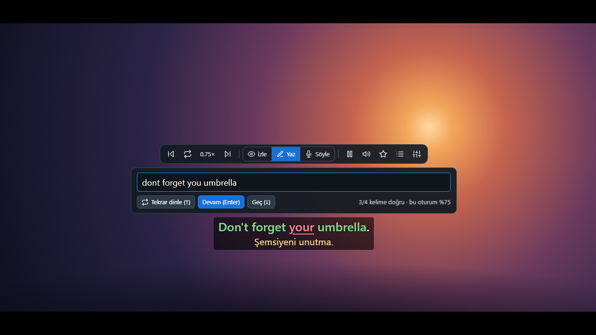
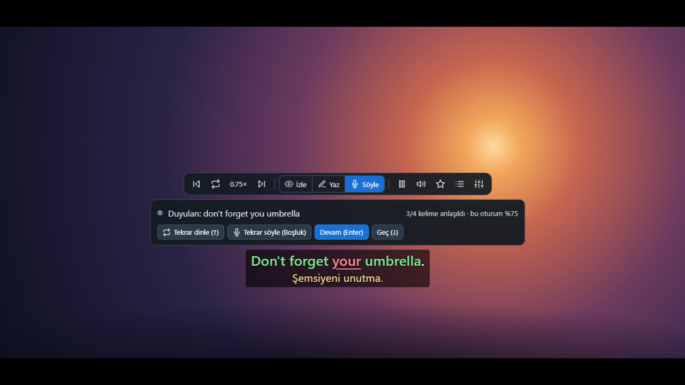
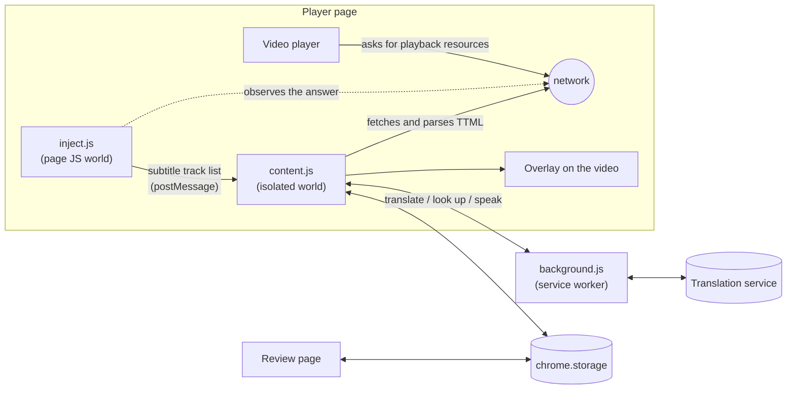

<p align="center"></p>

<h1 align="center">SceneLingo</h1>

<p align="center">
  Learn a language from the films, series and videos you already watch.<br>
  Dual subtitles, instant word lookup with audio, listening and speaking practice, and spaced-repetition review — as a browser extension for Prime Video, YouTube and plain HTML5 video.
</p>

<p align="center">
  
  
  
</p>


## Why

I am learning English for IELTS and for work, and films are where I hear the language as it is really spoken.
The tool most people use for this, Language Reactor, does not work on Amazon Prime Video, which is what I watch.
So I built my own, kept adding the things I wanted while studying, and then took it to the other places I watch.

## Where it works

| Site | Subtitles come from |
| --- | --- |
| Amazon Prime Video | the subtitle tracks the player is offered |
| YouTube | the video's caption tracks, written or automatic; the translation is YouTube's own |
| Any other site (after you allow it) | the video's text tracks, subtitle files the page loads, or a `.srt` / `.vtt` file of your own |

## What it does

- **Dual subtitles.** The language you are learning on top, your own language below. If the service has a human
  translation it is used; where it does not line up with the original, or there is none, the line is
  machine-translated.
- **Word lookup on hover.** Point at a word: the video pauses and you get the translation, phonetic spelling and
  the word read aloud. Click to pin the card and see a definition and synonyms. Drag across several words to look
  up a phrase. Contractions are spelled out (`I'll = I will`).
- **Three ways to watch**, switched from a study bar above the subtitles:
  - **Watch** — subtitles as usual.
  - **Write** — the subtitle is hidden, the video pauses after each sentence, and you type what you heard. The
    line then appears with the words you got in green and the ones you missed in red.
  - **Speak** — after each sentence you say it aloud. The browser's speech recognition tells you which words it
    understood, and you can play your own recording back.
- **Hear it again, slower.** Replay a line from the film at three-quarter speed, or have a word or sentence read
  by a British, American or Australian voice, at a volume you set.
- **Spaced-repetition review.** Words, phrases and sentences you save come back as flashcards on a schedule
  (1, 3, 8, 20… days), each with the sentence it came from.
- **Sentence navigation.** Jump to the previous or next line, repeat the current one, pause automatically after
  every line, or pick a line from the transcript.

| Write what you heard | Say the line |
| --- | --- |
|  |  |

| Review | Transcript |
| --- | --- |
|  |  |

The screenshots are taken from the test harness, which draws its own backdrop, so they contain no film footage.

## How it works



1. **Finding the subtitles.** A small script runs in the page's own JavaScript world from `document_start` and
   wraps `fetch`, `XMLHttpRequest` and `JSON.parse`. When the player receives its playback resources, the script
   picks out the list of subtitle tracks and hands only that list to the content script. Nothing else is read.
2. **Parsing.** The content script downloads the two tracks it needs and parses the TTML itself, including the
   clock, frame and tick time formats, and merges lines that are positioned separately but timed together.
3. **Drawing.** An overlay is laid over the video and updated every frame from the video's clock. It follows the
   player into fullscreen, and keeps away from videos that are not the player, such as the trailer on a title's
   page, an advertisement or a preview.
4. **Staying in sync.** The video clock and the subtitle timeline can drift apart (after ads, for example). When the
   player's own captions are on, the extension notices when a line appears, matches it to a cue, and corrects
   the offset from the median of three matches.
5. **Translating and speaking.** Requests go through the service worker. Machine translation is fetched lazily,
   twenty lines at a time around the playhead; lookups and audio are cached.

The steps above are Prime Video's. What differs from site to site is small and kept in one place: where the
subtitles come from, which video counts as the one being watched, and where the overlay is attached. On YouTube a
second page-world script reads the caption track list from the player; on any other site the content script reads
the video's own text tracks, and parses WebVTT, SubRip, TTML and YouTube's JSON captions alike.

## Engineering notes

- **No dependencies and no build step.** Plain JavaScript, loadable as it is.
- **Access is asked for, not assumed.** The extension is installed with access to Prime Video and YouTube only.
  Running on other sites is a switch in the toolbar popup: turning it on asks the browser for the permission and
  registers the content script for all pages; turning it off gives the permission back. On a site it does not
  know, it stays out of sight unless the video has subtitles or you ask for it.
- **YouTube only hands captions to its own player.** A caption file is served to a request that carries tokens
  the player computes; the address in the page's data returns an empty file. So the page-world script notes the
  address of a request the player itself makes and asks for the other languages at that address, switching the
  captions on (a few times, if the player was still starting) when no request has been seen yet.
- **Two subtitle tracks that were never meant to line up.** The original and the translation are cut and timed
  separately. Each line shows the translated cue that overlaps it most, and when one translated cue covers
  several lines, those lines get a translation of their own, so a line never shows more than it says.
- **Sharing a page with a player that wants the keyboard.** While you type an answer, every key belongs to the
  answer box, wherever the player has moved the focus; the focus is taken back when it is moved away, but not
  while you are selecting subtitle text; and mouse presses on the overlay never reach the page, so a player that
  cancels them cannot stop words from being selected. Each of these came from a bug found in real use, and the
  harness now has a "strict player" mode that behaves the same way. A shortcut key is also taken from press to
  release, because a player may act on the release: Prime Video opened its audio menu when `A` was let go.
- **Slow playback is real signal processing.** The speech service's "slow" voice is only about 18 % slower, so
  the audio is time-stretched in the browser with a small WSOLA implementation
  ([`core.js`](extension/core.js)). A unit test feeds it a sine wave and checks that it gets longer while its
  frequency and level stay the same.
- **Speaking practice without a server.** The Web Speech API transcribes the attempt; the recogniser's
  alternative readings are compared with the line and the closest is kept, and the words are scored with the
  same longest-common-subsequence match as typed answers. The attempt is also recorded with `MediaRecorder` and
  played back through the extension's own audio graph.
- **Pausing at the end of a line survives a stalled frame.** If the page misses the pause window, the next frame
  notices and steps back to just before the line ended.
- **Review scheduling** is a compact SM-2 variant.
- **Tested without the real site.** [`test/harness.html`](test/harness.html) mimics the parts of the player the
  extension relies on and runs the real extension files against mocked extension APIs, with stand-ins for the
  microphone and the speech recogniser. The README screenshots are produced from it by headless Chrome.
- **And with it, where that is possible.** [`test/real-browser.js`](test/real-browser.js) loads the unpacked
  extension into a browser with a throwaway profile and drives a YouTube video over the DevTools protocol, with
  no test framework: first line, next line, writing practice, the tracks on offer.

## Install

1. Download or clone this repository.
2. Open `chrome://extensions` (or `edge://extensions`) and turn on **Developer mode**.
3. Choose **Load unpacked** and select the `extension` folder.
4. Play something on Prime Video or YouTube and move the mouse: the study bar appears above the subtitles.
5. For other sites, open the toolbar popup and turn on **Diğer sitelerde de çalış** ("work on other sites too").
   If a video there has no subtitles, **Bu sekmedeki videoda aç** brings up the bar, and the settings menu on it
   opens a subtitle file from your disk.

The interface is currently in Turkish. The learning language and your own language are set in the toolbar popup.

## Shortcuts

| Key | Action |
| --- | --- |
| `A` / `D` | Previous / next line |
| `S` / `Z` | Repeat the current line / repeat it at three-quarter speed |
| `Q` | Pause after every line |
| `W` / `E` | Writing practice / speaking practice on or off |
| `L` | Transcript panel (not on YouTube, where `L` skips ahead; use the button) |
| `Enter`, `↑`, `↓` | In practice: check or continue, hear the line again, skip it |
| `Space`, `→` | In speaking practice: say it again, play your own recording |
| `Space`, `1` `2` `3`, `R` | On the review page: show the answer, grade it, replay the audio |

## Development

```bash
npm test                # unit tests (Node's built-in runner, Node 22+)
npm run harness         # mock player at http://localhost:8765
npm run check:youtube   # the real extension on YouTube, in Microsoft Edge (needs the network)
```

| Path | What is there |
| --- | --- |
| `extension/inject.js`, `youtube.js` | Page-world scripts that find the subtitle tracks on Prime Video and on YouTube |
| `extension/content.js` | Overlay, playback control, word card, study bar, practice modes, what differs per site |
| `extension/core.js` | Pure logic: subtitle formats, cue search and alignment, word matching, time-stretch |
| `extension/background.js` | Service worker: translation, lookup and speech requests; access to other sites |
| `extension/review.*`, `popup.*` | Flashcard page and toolbar popup |
| `extension/shared.js` | Default settings and the review schedule |
| `test/unit/` | Unit tests |
| `test/harness.html`, `server.js`, `mock-chrome.js` | Mock player, static server, mocked extension APIs |

Useful harness pages: `/` (player), `/?strict` (a player that steals focus and cancels mouse presses),
`/?caps` (captions in capitals with a differently cut translation), `/?page` (the video set into a page that
scrolls, where nothing should be drawn), `/?site=other&tracks` (a plain video with `<track>` subtitles),
`/?site=other` (a plain video with none), `/extension/review.html?mock&seed`,
`/extension/popup.html?mock&seed`. Adding `shot=popup`, `write`, `speak`, `transcript` or `review` puts a page
into the state used for the screenshots.

## Limitations and roadmap

- Prime Video and YouTube are supported by name. Other sites work as far as their player is a plain HTML5
  video: text tracks, subtitle files the page loads, or a file of your own. A site that keeps its subtitles to
  itself, as Netflix does, needs an adapter like the two that exist. Only YouTube was checked with the extension
  loaded in a real browser by the script above; Prime Video needs an account and is checked by hand.
- On YouTube the first line can take some seconds after a cold start, until the player has made a caption
  request of its own. Automatic captions come without punctuation, in short pieces.
- Translation, definitions and speech come from Google Translate's unofficial web endpoints. They are free and
  need no key, but they are not a supported API: they can change or rate-limit without notice. This makes the
  project suitable for personal study, not for a published product as it stands. Chrome's built-in Translator
  API is the planned replacement for sentence translation.
- Speaking practice uses the browser's speech recognition, which in Chrome sends the audio to Google. It tells
  you whether you were understood, word by word; it does not grade individual sounds, and it is forgiving of an
  accent.
- Definitions and synonyms are available for single English words; phrases get a translation only.
- Planned: interface in English, word-level tags for academic and business vocabulary, fill-in-the-blank review
  cards, Anki export.

## Disclaimer

SceneLingo is a personal, educational project. It is not affiliated with or endorsed by Amazon or Google; Prime
Video and YouTube are trademarks of their owners. The extension does not download or decrypt video: it reads the
plain-text subtitle files the player itself requests, and only while you are watching.

## License

[MIT](LICENSE) © 2026 Umut. Icon shapes are adapted from [Feather](https://feathericons.com) (MIT).
