<p align="center"></p>

<h1 align="center">SceneLingo</h1>

<p align="center">
  <b>Learn a language from the films, series and videos you already watch.</b><br>
  A browser extension that puts two subtitle lines on the video, explains any word you point at,<br>
  and turns each sentence into listening and speaking practice.
</p>

<p align="center">
  <a href="README.tr.md">Türkçe</a> ·
  <a href="#install">Install</a> ·
  <a href="#where-it-works">Where it works</a> ·
  <a href="#how-it-works">How it works</a> ·
  <a href="#engineering-notes">Engineering notes</a>
</p>

<p align="center">
  <a href="https://github.com/umutgokbulak/SceneLingo/actions/workflows/ci.yml"></a>
  
  
  
  
</p>

<p align="center">
  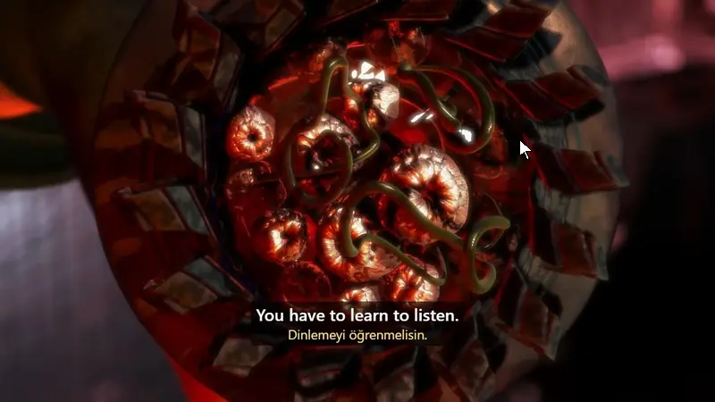
</p>

<p align="center"><sub>
  The film in the pictures is <a href="https://commons.wikimedia.org/wiki/File:Elephants_Dream_(2006).webm"><i>Elephants Dream</i></a>
  (© Blender Foundation | Netherlands Media Art Institute, <a href="https://creativecommons.org/licenses/by/2.5/">CC BY 2.5</a>),
  with its own English and Turkish subtitles.
</sub></p>

## At a glance

- **For the learner:** the line in the language you are learning with your own language under it; a word's
  meaning, sound and definition when you point at it; every sentence as a dictation or a speaking exercise;
  flashcards that come back on a schedule.
- **Where:** Amazon Prime Video, Netflix, YouTube, and any site whose subtitles can be found from outside the page
  (TED, Vimeo's player and Wikimedia Commons were checked) — or any video at all, with a subtitle file of your own.
- **How it is built:** Manifest V3, plain JavaScript, no dependencies and no build step; 115 unit tests, a
  stand-in player for everything that can be tested without a site, and a script that loads the real extension
  into a real browser for what cannot.

## Why

I am learning English for IELTS and for work, and films are where I hear the language as it is really spoken.
The tool most people use for this, Language Reactor, does not work on Amazon Prime Video, which is what I watch.
So I built my own, kept adding the things I wanted while studying, and then took it to the other places I watch.

## Where it works

| Site | Subtitles come from |
| --- | --- |
| Amazon Prime Video | the subtitle tracks the player is offered |
| Netflix | the subtitle tracks of the title's manifest, which the player is made to ask for in WebVTT and TTML; seeking goes through Netflix's own player |
| YouTube | the video's caption tracks, written or automatic; the translation is YouTube's own |
| Any other site (after you allow it) | the list of subtitle tracks in the video's stream (HLS or DASH), the files its `<track>` elements point at, subtitle files the page loads, the video's own text tracks, or a `.srt` / `.vtt` / `.ass` file of your own |

"Any other site" was checked with the extension loaded in a real browser on TED (49 languages, Turkish among
them), plyr.io, Vimeo's player, Wikimedia Commons and a YouTube player embedded in another page.

## What it does

- **Dual subtitles.** The language you are learning on top, your own language below. If the service has a human
  translation it is used; where it does not line up with the original, or there is none, the line is
  machine-translated.
- **Word lookup on hover.** Point at a word: the video pauses and you get the translation, phonetic spelling and
  the word read aloud. Click to pin the card and see a definition and synonyms. Drag across several words to look
  up a phrase. Contractions are spelled out (`I'll = I will`).
- **Three ways to watch**, switched from a study bar above the subtitles:
  - **Watch** — subtitles as usual.
  - **Write** — the subtitle is hidden, the video pauses after each sentence, and you type what you heard. The
    line then appears with the words you got in green and the ones you missed in red.
  - **Speak** — after each sentence you say it aloud. The browser's speech recognition tells you which words it
    understood, and you can play your own recording back.
- **What a word means in its sentence.** A dictionary lists every meaning of "ripped"; in "you ripped off
  the wrong people" the card says *soymak*. The sentence is translated with the word marked, and the marked
  part of the translation is the answer. With your own free Gemini API key it also names the phrase the word
  belongs to and explains the use. Review cards show it, with the sentence's translation.
- **Select text on any page.** A small SL button appears beside it: translation, dictionary entry, voice,
  and a Save that sends it to review with the sentence it came from. Text in your own language is shown in
  the language you learn. On sites SceneLingo has no access to, right-click the selection.
- **Any language pair.** English is not built in: German subtitles with English under them work the same way
  as English with Turkish. The interface itself is in English or Turkish, following the browser.
- **Sentences translated inside the browser.** Where the browser has a translator of its own (Chrome and Edge
  do), the lines under the subtitle are translated on the computer: no limits, no network, and the subtitles
  do not leave it. The language pack is fetched once, from the toolbar popup.
- **Louder films.** The toolbar popup can raise the sound of the tab up to 600%, with a limiter so that it
  does not clip.
- **Hear it again, slower.** Replay a line from the film at three-quarter speed, or have a word or sentence read
  by a British, American or Australian voice, at a volume you set.
- **Spaced-repetition review that moves towards using the word.** A saved word is first recognised, then
  typed into the gap in its own sentence, then produced from its meaning, typed or said aloud; a miss steps back
  one. Typed answers are checked (a slip of the keyboard still counts), new cards are limited per day, and the
  toolbar icon shows how many are waiting.
- **Cards that grow.** A saved word met again in another film collects that sentence as an example, each with
  a button that opens its scene at the right moment. With a Gemini key a card also gets its CEFR level, common
  combinations, two more examples, and a check of a sentence you write with it. Cards can be edited, and a
  word can be turned into the phrase it belongs to ("ripped" into "rip off").
- **Listening practice.** The sentences your words came from are read out and you type what you hear; then,
  word by word, what you heard right, what nearly (spelt differently), what you missed and what is not in the
  sentence, with its meaning and, with Gemini, the words and phrases in it and what they mean there, each one a
  tap away from being saved. Any word of it opens its card. A sentence heard right rests for a week, a missed one comes back the next day.
  It works on the phone too.
- **Speaking practice.** Everyday situations (a café, a doctor's appointment, a new colleague, a job interview...)
  played out with Gemini in the language being learnt, at your level: you speak, it answers in character, and
  each thing you said is put right, to be saved with a star. In English, the IELTS Speaking test's three parts
  (with Part 2's minute to prepare and two to talk): each answer gets an estimated band on the four criteria,
  its mistakes put right, a band 8 answer and phrases to learn. Saved words come up as words to try; one used
  rightly keeps your sentence as an example.
- **Writing practice.** Everyday messages and letters (to a landlord, a teacher, a shop...) in the language
  being learnt, at your level: Gemini says what level the text shows and whether it did what was asked, puts
  its mistakes right and gives it back natural. In English, the IELTS Writing tasks against the clock (Task 1
  as a letter or a report on a table, Task 2 an essay): an estimated band on the four criteria, the mistakes, and
  the text rewritten at band 8. What is being written is kept as it is typed.
- **Reading practice.** Every day, a text of the kind you choose (a story, the news, travel, work, science...) in
  the language being learnt, at your level, with questions on it. In English, one passage of the IELTS Reading
  test, Academic or General Training, against the clock: matching headings, TRUE / FALSE / NOT GIVEN, multiple
  choice and sentence completion, thirteen questions as in a third of the test. Once checked, each answer says
  why, and a button marks the words of the text it comes from; IELTS gives an estimated band by the test's own
  tables. Then every word of the text opens its meaning, to be saved with its sentence. A test begun is kept.
- **One bar to every page:** today, the review, the words and the four kinds of practice, one tab each, at the
  top of every page (on a phone, at the foot of the screen); the review's tab says how many cards are waiting,
  and a practice done for today has a green dot.
- **Gemini's use, counted:** today's requests and tokens, and the last week, beside the key.
- **Today's plan, and the week.** Each day asks for the cards that are due, five sentences listened to and one
  conversation or spoken answer; the week, two texts written and two read. The popup shows what is left and opens what is next; a
  progress page shows the last seven days day by day, what they added up to, and the IELTS bands as they went.
  Any practice keeps the streak going. A notification at an hour you choose says what is still waiting; the goals are
  yours to change, or to leave out.
- **A record of the days:** streak, words learned, share remembered.
- **All your words in one place.** Every saved word, phrase and sentence, found by search (in the word, its
  meanings or its sentence), by kind, by source, or by where it stands (new, learning, learned, hard); each
  opens to everything known about it, and can be edited or deleted there.
- **Words heard elsewhere, added by hand** (on the phone too): its meaning and pronunciation are looked up and,
  with the sentence it was in, what it means there; without one, Gemini gives it a sentence and examples.
- **Backups.** The words live only in the browser, so the list makes a backup file and reads one back in,
  merging it with what is there; once a week it reminds you to make one.
- **An episode's own words, and questions on it.** The list of lines has two more tabs. *Words*: the words of
  this episode a learner at your level is not likely to know yet, found by how common each is in film subtitles
  (lists of the 20,000 commonest English and German words, from OpenSubtitles), with how often they come, their
  meaning, a jump to their line and a star to save them with it; names and sounds are left out, and so are the
  words you have saved. With Gemini, their meaning in their lines and the episode's idioms and phrasal verbs, asked
  once and kept. *Questions*: five questions on what you have watched so far, never on what comes later, each
  with where in the story the answer is.
- **Sentence navigation.** Jump to the previous or next line, repeat the current one, pause automatically after
  every line, or pick a line from the transcript.

| A word, explained | Every line, beside the film |
| --- | --- |
| 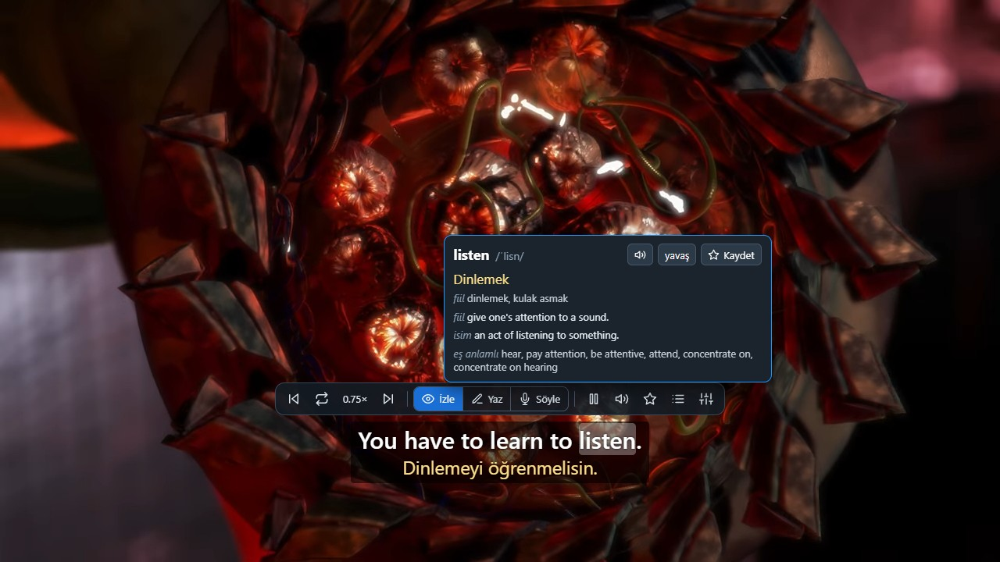 | 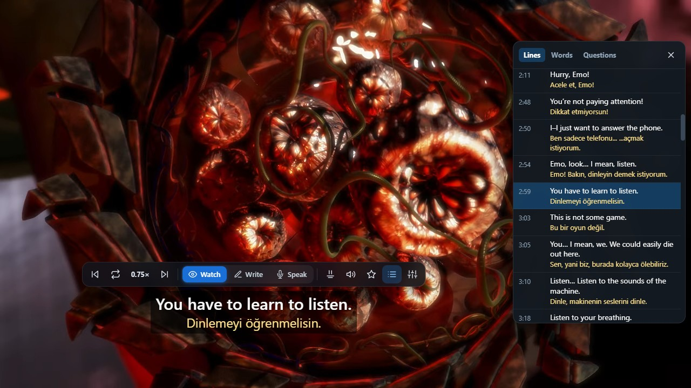 |

| Write what you heard | Say the line |
| --- | --- |
| 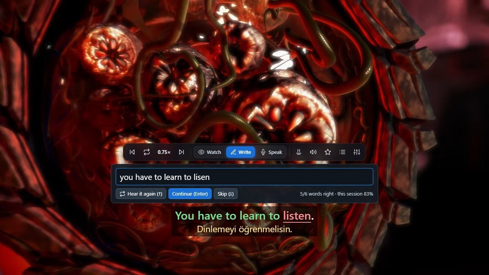 | 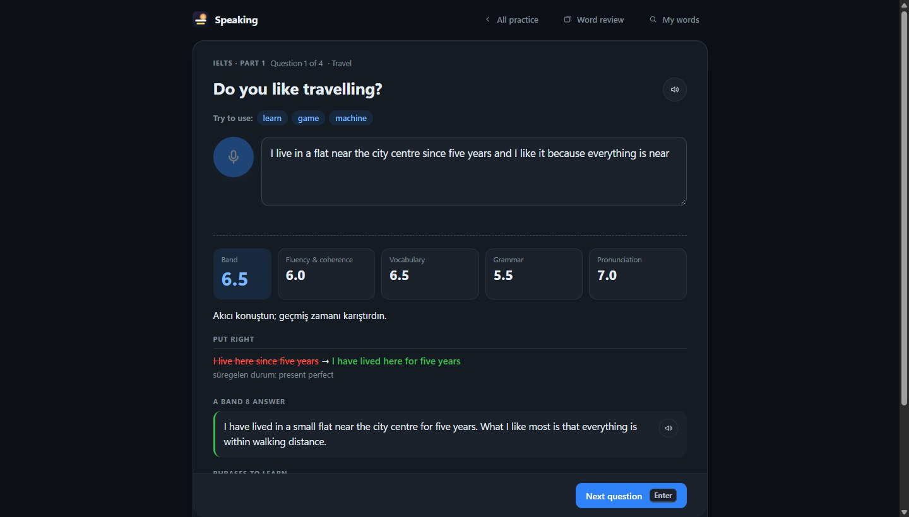 |

| IELTS Speaking | Everyday conversation |
| --- | --- |
|  | 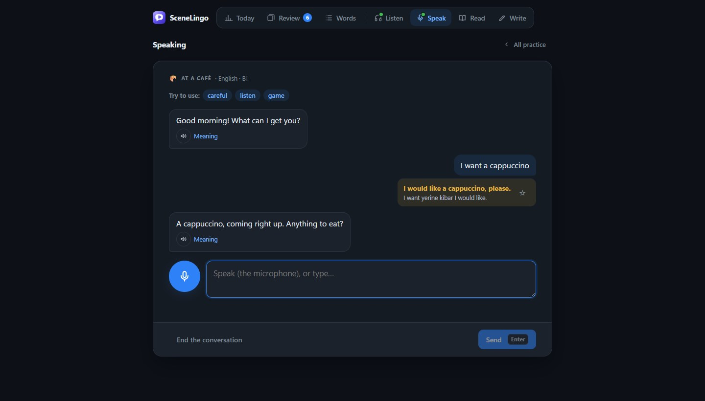 |

| An episode's words | |
| --- | --- |
| 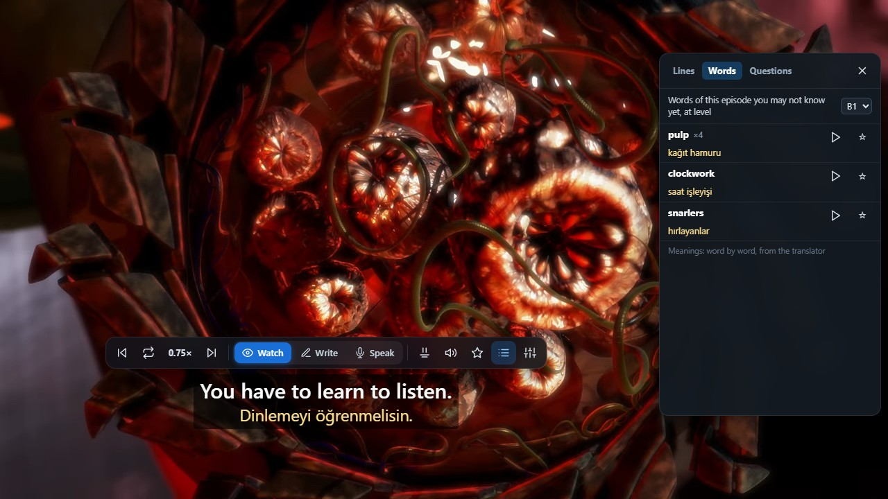 | |

| Progress | IELTS Writing |
| --- | --- |
| 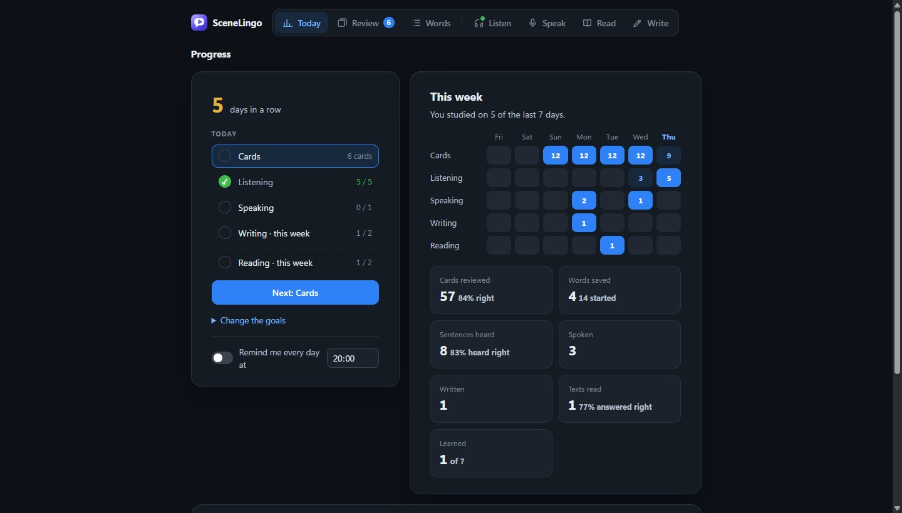 | 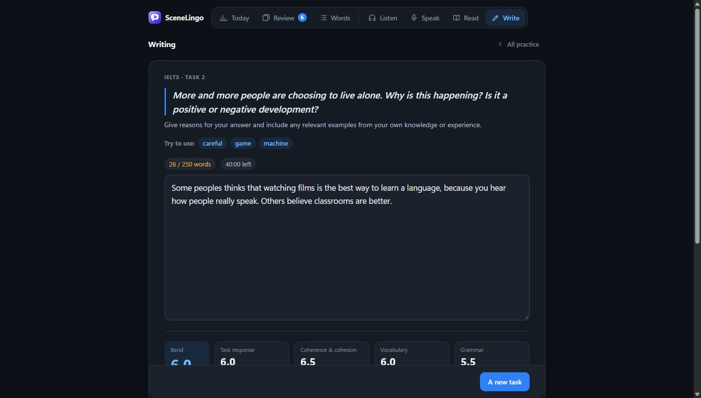 |

| IELTS Reading | |
| --- | --- |
| 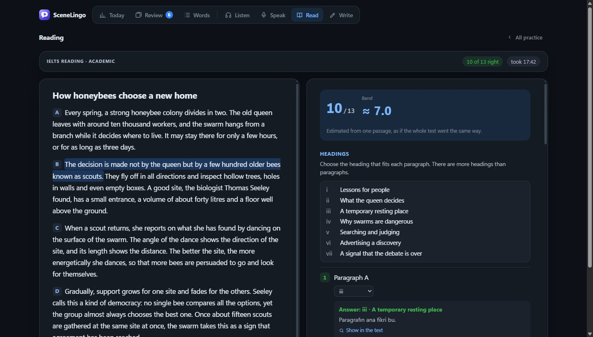 | |

| Listening practice | |
| --- | --- |
|  | |

| Review | All your words |
| --- | --- |
|  | 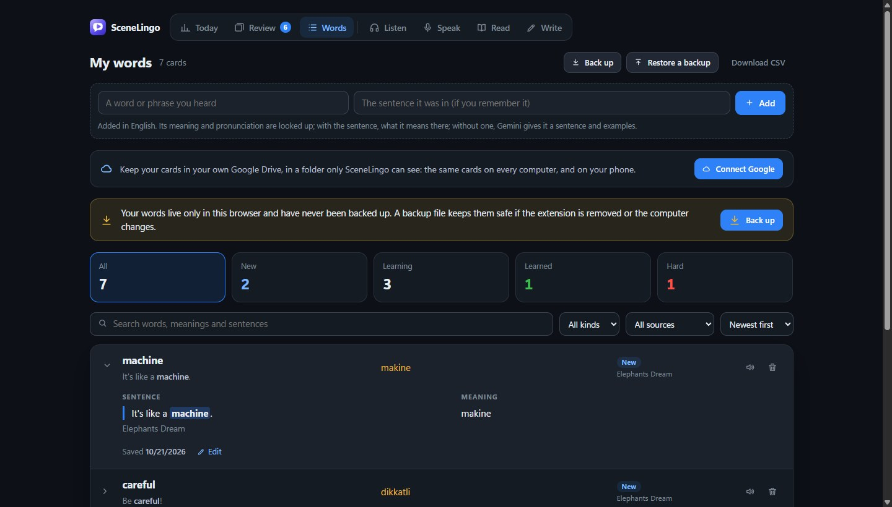 |

The pictures are the extension itself in a real browser, taken by [`test/pictures.js`](test/pictures.js) and
[`test/pages.js`](test/pages.js). The speaking one uses a stand-in for the microphone and the speech recogniser;
the review and the list show sample cards made from the film's lines.

## How it works

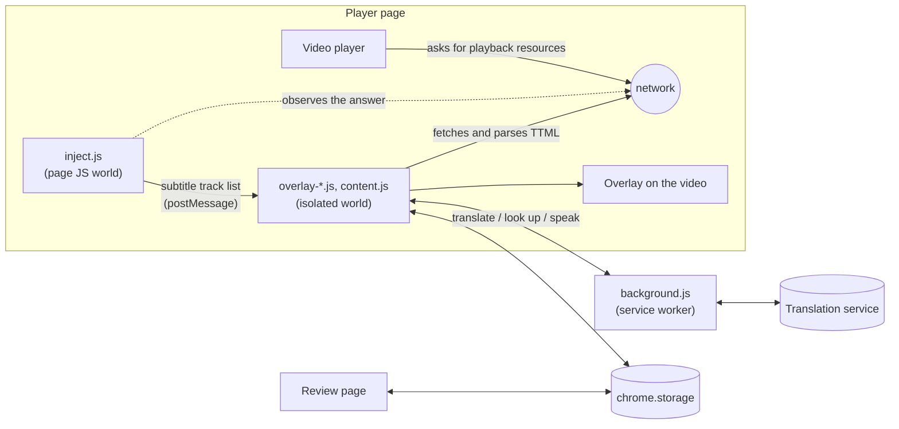

1. **Finding the subtitles.** A small script runs in the page's own JavaScript world from `document_start` and
   wraps `fetch`, `XMLHttpRequest` and `JSON.parse`. When the player receives its playback resources, the script
   picks out the list of subtitle tracks and hands only that list to the content script. Nothing else is read.
2. **Parsing.** The content script downloads the two tracks it needs and parses the TTML itself, including the
   clock, frame and tick time formats, and merges lines that are positioned separately but timed together.
3. **Drawing.** An overlay is laid over the video and updated every frame from the video's clock. It follows the
   player into fullscreen, and keeps away from videos that are not the player, such as the trailer on a title's
   page, an advertisement or a preview.
4. **Staying in sync.** The video clock and the subtitle timeline can drift apart (after ads, for example). When the
   player's own captions are on, the extension notices when a line appears, matches it to a cue, and corrects
   the offset from the median of three matches.
5. **Translating and speaking.** Requests go through the service worker. Machine translation is fetched lazily,
   twenty lines at a time around the playhead; lookups and audio are cached.

The steps above are Prime Video's. What differs from site to site is small and kept in one place: where the
subtitles come from, which video counts as the one being watched, and where the overlay is attached. On YouTube a
second page-world script reads the caption track list from the player. On any other site nothing is put into the
page at all: [`subtitles.js`](extension/subtitles.js) finds the subtitles from outside, and reads WebVTT, SubRip,
TTML, SubStation and YouTube's JSON captions alike.

## Engineering notes

- **No dependencies and no build step.** Plain JavaScript, loadable as it is.
- **Access is asked for, not assumed.** The extension is installed with access to Prime Video, Netflix and YouTube only.
  Running on other sites is a switch in the toolbar popup: turning it on asks the browser for the permission and
  registers the content script for all pages; turning it off gives the permission back. On a site it does not
  know, it stays out of sight unless the video has subtitles or you ask for it.
- **YouTube only hands captions to its own player.** A caption file is served to a request that carries tokens
  the player computes; the address in the page's data returns an empty file. So the page-world script notes the
  address of a request the player itself makes and asks for the other languages at that address, switching the
  captions on (a few times, if the player was still starting) when no request has been seen yet.
- **Finding subtitles on a site it has never seen.** A player has to fetch its subtitles, and the browser keeps
  the addresses of everything a page fetches. A `PerformanceObserver` on that list finds the stream's manifest
  and the subtitle files without patching the page's network functions. From the manifest come all the subtitle
  tracks with their names, not just the one the player has loaded; an HLS track is put together from its pieces,
  each brought to the first one's clock, with a line that was cut at a join made whole again. Picture lists for
  the seek bar, which are WebVTT files too, are told apart and left out.
- **Whose clock?** TED's subtitle files start 3.6 seconds before its videos do. When the page's own text track
  is showing a line that is also in the copy put together from the stream, the two start times give the
  difference, and the copy is shifted.
- **Which video?** An advertisement plays in a video of its own, laid over the film and just as large. The video
  with subtitle tracks is preferred, and nothing is drawn while another video plays on top of it. A stream whose
  length does not match the video's is not that video's.
- **A video that goes fullscreen by itself** leaves nothing of the page on screen. The overlay is then shown as
  a popover, which is drawn in the browser's top layer above the video. The browser does not let the mouse
  through to it there, so the study bar is put away, the shortcuts keep working, and a word is found from where
  the pointer is. Players that keep their video in a shadow tree are entered with `chrome.dom`, and the
  video's events, which do not leave that tree, are listened for inside it.
- **Two subtitle tracks that were never meant to line up.** The original and the translation are cut and timed
  separately. Each line shows the translated cue that overlaps it most, and when one translated cue covers
  several lines, those lines get a translation of their own, so a line never shows more than it says.
- **Sharing a page with a player that wants the keyboard.** While you type an answer, every key belongs to the
  answer box, wherever the player has moved the focus; the focus is taken back when it is moved away, but not
  while you are selecting subtitle text; and mouse presses on the overlay never reach the page, so a player that
  cancels them cannot stop words from being selected. Each of these came from a bug found in real use, and the
  harness now has a "strict player" mode that behaves the same way. A shortcut key is also taken from press to
  release, because a player may act on the release: Prime Video opened its audio menu when `A` was let go.
- **Slow playback is real signal processing.** The speech service's "slow" voice is only about 18 % slower, so
  the audio is time-stretched in the browser with a small WSOLA implementation
  ([`core.js`](extension/core.js)). A unit test feeds it a sine wave and checks that it gets longer while its
  frequency and level stay the same.
- **Speaking practice without a server.** The Web Speech API transcribes the attempt; the recogniser's
  alternative readings are compared with the line and the closest is kept, and the words are scored with the
  same longest-common-subsequence match as typed answers. The attempt is also recorded with `MediaRecorder` and
  played back through the extension's own audio graph.
- **Pausing at the end of a line survives a stalled frame.** If the page misses the pause window, the next frame
  notices and steps back to just before the line ended.
- **Review scheduling** is a compact SM-2 variant, with stages from recognising to producing on top (`extension/study.js`).
- **Tested without the real site.** [`test/harness.html`](test/harness.html) mimics the parts of the player the
  extension relies on and runs the real extension files against mocked extension APIs, with stand-ins for the
  microphone and the speech recogniser.
- **And with it, where that is possible.** [`test/real-browser.js`](test/real-browser.js) loads the unpacked
  extension into a browser with a throwaway profile and drives it over the DevTools protocol, with no test
  framework: a YouTube video (first line, next line, writing practice, the tracks on offer), and a round of
  other sites, for which the browser is given a copy of the extension that already holds the permission a
  person would be asked for.

## Install

1. Download or clone this repository.
2. Open `chrome://extensions` (or `edge://extensions`) and turn on **Developer mode**.
3. Choose **Load unpacked** and select the `extension` folder.
4. Play something on Prime Video or YouTube and move the mouse: the study bar appears above the subtitles.
5. For other sites, open the toolbar popup and turn on **Diğer sitelerde de çalış** ("work on other sites too").
   The bar then appears on any video that comes with subtitles. If a video has none, **Bu sekmedeki videoda aç**
   brings up the bar, and the settings menu on it opens a subtitle file from your disk. **Bu sitede çalış**
   switches the extension off for the site in the current tab.

The interface is in English or Turkish (it follows the browser, or the choice in the toolbar popup). The language you learn and your own are set there too.

## On your phone, and on every computer

Connect Google on the **My words** page and the cards are kept in your own Google Drive, in a folder only
SceneLingo can see (Drive's app data folder). Every browser with the extension syncs with it: every half hour,
a minute after the cards change, and when the day's review is done. Two copies are merged card by card; a card
changed later wins, and a deletion is remembered so that an older copy does not bring the card back.

On a phone, the same review and word pages run as a web page:
[umutgokbulak.github.io/SceneLingo/extension/words.html](https://umutgokbulak.github.io/SceneLingo/extension/words.html).
Sign in with the same Google account; on an iPhone, Safari's **Share → Add to Home Screen** makes it an app.
Words are spoken by the phone's own voices. Watching with dual subtitles stays on the computer: phone browsers
do not run this extension, and streaming apps cannot be extended.

There is no server of ours. The sign-in is Google's own page, and the token it gives lets SceneLingo read and
write that one folder for an hour. The extension has a fixed ID (the `key` in the manifest), because the sign-in
returns to an address made from it.

### Setting up the Google sign-in

Done once, by whoever publishes the extension; it is free.

1. At [console.cloud.google.com](https://console.cloud.google.com), create a project and enable the
   **Google Drive API** for it.
2. Under **Google Auth Platform**, set up the consent screen: app name, support e-mail, audience **External**.
   While the app is in testing, add the Google accounts that will use it as **test users** (up to 100).
   Under **Data access**, add the scopes `.../auth/drive.appdata` and `email`.
3. Under **Clients**, create an **OAuth client** of type **Web application** with
   - authorised JavaScript origin `https://umutgokbulak.github.io`
   - authorised redirect URIs `https://llafhipfpgghcnijbfhinpndphnfmaba.chromiumapp.org/`,
     `https://umutgokbulak.github.io/SceneLingo/extension/words.html` and
     `https://umutgokbulak.github.io/SceneLingo/extension/review.html`.
4. Put its client ID in `SL_CLOUD.clientId` in [`extension/cloud.js`](extension/cloud.js). The client ID is
   public by design: it names the app to Google and gives nothing without the user's own sign-in.

Until the app is verified by Google, the sign-in shows a warning that the app is unverified; test users can go on.

## Shortcuts

| Key | Action |
| --- | --- |
| `A` / `D` | Previous / next line |
| `S` / `Z` | Repeat the current line / repeat it at three-quarter speed |
| `Q` | Pause after every line |
| `W` / `E` | Writing practice / speaking practice on or off |
| `L` | Transcript panel (not on YouTube, where `L` skips ahead; use the button) |
| `Enter`, `↑`, `↓` | In practice: check or continue, hear the line again, skip it |
| `Space`, `→` | In speaking practice: say it again, play your own recording |
| `Space` / `Enter`, `1` `2` `3`, `R` | On the review page: show or check the answer, grade it, replay the audio |

## Development

```bash
npm test                # unit tests (Node's built-in runner, Node 22+)
npm run harness         # mock player at http://localhost:8765
npm run check:youtube   # the real extension on YouTube, in Google Chrome (needs the network)
npm run check:sites     # the same on TED, plyr.io, Vimeo's player and Wikimedia Commons
npm run check:pages     # the review page and the list of words, driven in a real browser
npm run pictures        # the stills of this README; `npm run film` and test/animate.py make the short film
npm run pictures:pages  # the pictures of the review page and the list of words
```

| Path | What is there |
| --- | --- |
| `extension/inject.js`, `youtube.js`, `netflix.js` | Page-world scripts that find the subtitle tracks on Prime Video, YouTube and Netflix |
| `extension/subtitles.js` | Reading subtitle files; finding the subtitles of a video on a site that is not known |
| `extension/episode.js`, `freq/` | An episode's words to learn: how common each word is in film subtitles (lists under CC BY-SA 4.0, see `freq/README.md`) |
| `extension/overlay-*.js`, `content.js` | The overlay, one content script in eight files loaded in order: its state (`overlay-base`), the tracks and their translation (`-tracks`), the lines kept in step with the picture and playback (`-lines`), the word card (`-words`), writing and speaking practice (`-practice`), the bar, its menu and the list of lines (`-ui`), the list's tabs of the episode's words and questions (`-episode`); `content.js` listens and starts it |
| `extension/read.*`, `reading.js` | Reading practice: the page, and the test Gemini writes put in order, marked and turned into a band |
| `extension/core.js` | Pure logic: subtitle and playlist formats, cue search and alignment, word matching, time-stretch |
| `extension/background.js` | Service worker: translation, lookup and speech requests; access to other sites |
| `extension/review.*`, `words.*`, `popup.*` | Review page, list of all words, toolbar popup |
| `extension/ui.*` | What the extension's own pages share: colours, light and dark, buttons, icons |
| `extension/shared.js` | Default settings and the review schedule |
| `extension/study.js` | Card stages, gap and answer checking, the day's queue, the record of the days |
| `test/unit/` | Unit tests |
| `test/harness.html`, `server.js`, `mock-chrome.js` | Mock player, static server, mocked extension APIs |

Useful harness pages: `/` (player), `/?strict` (a player that steals focus and cancels mouse presses),
`/?caps` (captions in capitals with a differently cut translation), `/?page` (the video set into a page that
scrolls, where nothing should be drawn), `/?site=other&tracks` (a plain video with `<track>` subtitles),
`/?site=other&hls` and `&dash` (a stream that lists its subtitles in its manifest), `&shadow` (the video in a
shadow tree), `/?site=other` (a plain video with none), `/extension/review.html?mock&seed`,
`/extension/popup.html?mock&seed`. Adding `shot=popup`, `write`, `speak`, `transcript` or `review` puts a page
into a fixed state for a picture. `/test/plain.html` and `/test/embed.html` are ordinary pages with a video and
with a YouTube player in a frame, for trying the real extension on; `/test/film.html` is the page the pictures
above were taken on.

## Limitations and roadmap

- Prime Video, Netflix and YouTube are supported by name; other sites as far as their subtitles can be found from
  outside the page. They cannot when a stream packs them inside MP4 fragments, or when the address of a file
  does not look like a subtitle file's; a file of your own still works there. A service that keeps its
  subtitles to itself needs an adapter like the three that exist. Subtitles of a live broadcast are followed
  only through the video's own text tracks.
- Prime Video and Netflix need an account and are checked by hand; Netflix's part is also checked against a
  stand-in of its player ([`test/netflix.html`](test/netflix.html), `npm run check:netflix`). Netflix changes its
  player without notice; when its subtitles stop coming, its adapter (`extension/netflix.js`) is the place to
  look. The other sites named above are checked by the script.
- Over a video that is fullscreen by itself, the mouse only reaches the subtitle words; the bar is not there.
- On YouTube the first line can take some seconds after a cold start, until the player has made a caption
  request of its own. Automatic captions come without punctuation, in short pieces.
- Sentences are translated by the browser's own translator once its language pack is there. Before that, and
  for a word's dictionary entry and its voice, Google Translate's unofficial web endpoint is used: free and
  without a key, but not a supported API, so it can change or rate-limit without notice.
- Speaking practice uses the browser's speech recognition, which in Chrome sends the audio to Google. It tells
  you whether you were understood, word by word; it does not grade individual sounds, and it is forgiving of an
  accent.
- Definitions and synonyms are available for single English words; phrases get a translation only.
- What Gemini does (a word's meaning in its sentence, the IELTS bands, the conversations, putting a text right,
  writing a reading test)
  needs your own free key, and is held to the free tier's daily and per-minute limits, which the popup's counter
  helps to watch. The bands are an estimate from what was written or recognised, not an examiner's score; a
  reading band is from one passage, a third of the real test, and a passage Gemini wrote may now and then have a
  question that can be argued (each answer says why, and where in the text).
- The phone gets no reminders: a web page can only be woken by a push server, which this project does not run.
- Planned: Anki export, and a listing in the Chrome Web Store so that updates arrive by themselves.

## Disclaimer

SceneLingo is a personal, educational project. It is not affiliated with or endorsed by Amazon or Google; Prime
Video and YouTube are trademarks of their owners. The extension does not download or decrypt video: it reads the
plain-text subtitle files the player itself requests, and only while you are watching.

## License

[MIT](LICENSE) © 2026 Umut. Icon shapes are adapted from [Feather](https://feathericons.com) (MIT).
