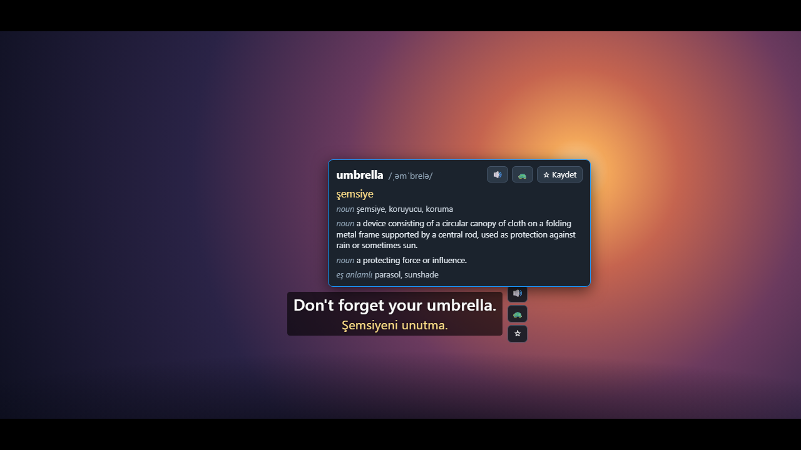
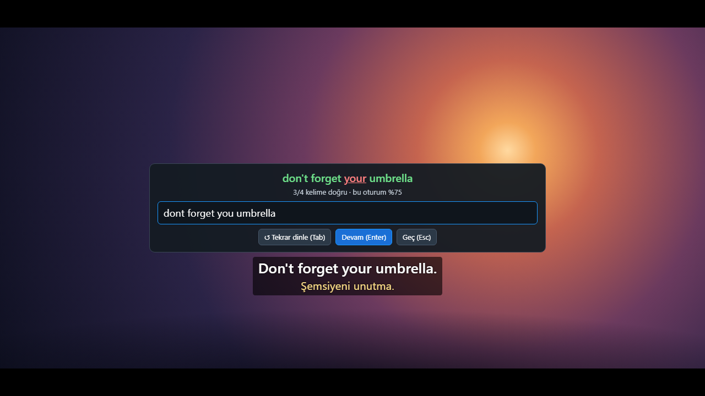
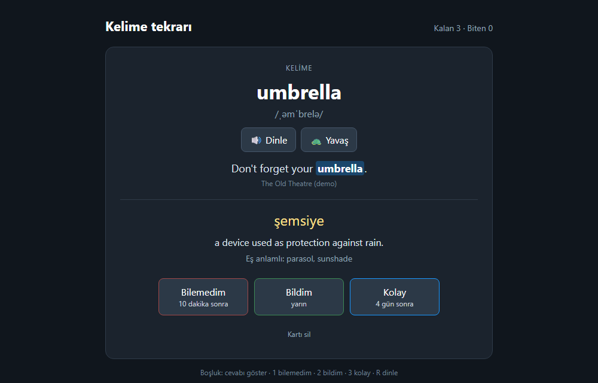
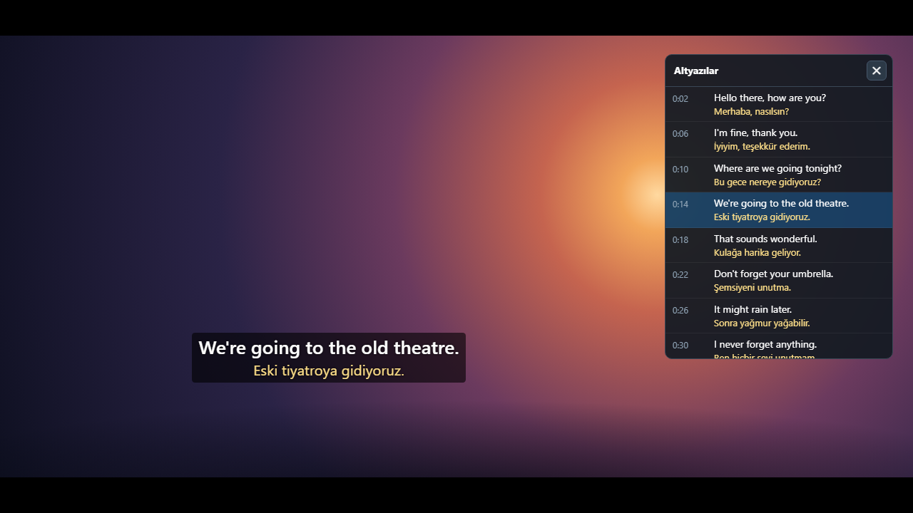
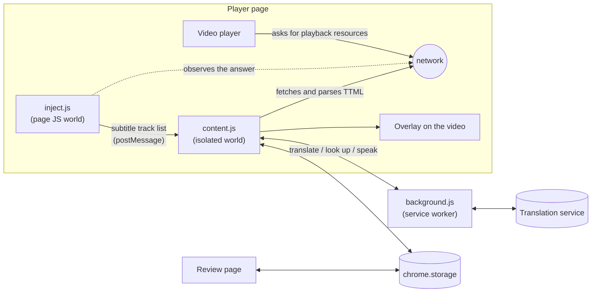

<p align="center"></p>

<h1 align="center">SceneLingo</h1>

<p align="center">
  Learn a language from the films and series you already watch.<br>
  Dual subtitles, instant word lookup with audio, spaced-repetition review and listening practice — as a browser extension.
</p>

<p align="center">
  
  
  
</p>



## Why

I am learning English for IELTS and for work, and films are where I hear the language as it is really spoken.
The tool most people use for this, Language Reactor, does not work on Amazon Prime Video, which is what I watch.
So I built my own, and kept adding the things I wanted while studying.

## What it does

- **Dual subtitles.** The language you are learning on top, your own language below. If the service has a human
  translation it is used; otherwise the lines are machine-translated as you watch.
- **Word lookup on hover.** Point at a word: the video pauses and you get the translation, phonetic spelling,
  a definition, synonyms, and the word read aloud. Click to pin the card. Drag across several words to look up a phrase.
- **Real audio, at your pace.** Choose a British, American or Australian voice, set the volume (up to 300 %), and
  use the turtle button to hear a word or a whole sentence slowed down without the pitch dropping.
- **Listening practice.** Subtitles are hidden, the video pauses after each sentence, and you type what you heard.
  Your answer is compared word by word with the real line.
- **Spaced-repetition review.** Words, phrases and sentences you save come back as flashcards on a schedule
  (1, 3, 8, 20… days), each with the sentence it came from.
- **Sentence navigation.** Jump to the previous or next line, repeat the current one, pause automatically after
  every line, or pick a line from the transcript.

| Listening practice | Review | Transcript |
| --- | --- | --- |
|  |  |  |

The screenshots are taken from the test harness, which draws its own backdrop, so they contain no film footage.

## How it works



1. **Finding the subtitles.** A small script runs in the page's own JavaScript world from `document_start` and
   wraps `fetch`, `XMLHttpRequest` and `JSON.parse`. When the player receives its playback resources, the script
   picks out the list of subtitle tracks and hands only that list to the content script. Nothing else is read.
2. **Parsing.** The content script downloads the two tracks it needs and parses the TTML itself, including the
   clock, frame and tick time formats, and merges lines that are positioned separately but timed together.
3. **Drawing.** An overlay is laid over the video and updated every frame from the video's clock. It follows the
   player into fullscreen.
4. **Staying in sync.** The video clock and the subtitle timeline can drift apart (after ads, for example). When the
   player's own captions are on, the extension notices when a line appears, matches it to a cue, and corrects
   the offset from the median of three matches.
5. **Translating and speaking.** Requests go through the service worker. Machine translation is fetched lazily,
   twenty lines at a time around the playhead; lookups and audio are cached.

## Engineering notes

- **No dependencies and no build step.** Plain JavaScript, loadable as it is. Permissions: `storage` and one host.
- **Slow playback is real signal processing.** The speech service's "slow" voice is only about 18 % slower, so
  the audio is time-stretched in the browser with a small WSOLA implementation
  ([`core.js`](extension/core.js)). A unit test feeds it a sine wave and checks that it gets longer while its
  frequency and level stay the same.
- **Volume above 100 %** is a Web Audio gain stage followed by a limiter, so boosted speech does not clip.
- **Pausing at the end of a line survives a stalled frame.** If the page misses the pause window, the next frame
  notices and steps back to just before the line ended.
- **Review scheduling** is a compact SM-2 variant; **listening practice** scores answers with a longest common
  subsequence over words, forgiving punctuation, case and missing apostrophes.
- **Tested without the real site.** [`test/harness.html`](test/harness.html) mimics the parts of the player the
  extension relies on and runs the real extension files against mocked extension APIs. The README screenshots are
  produced from it by headless Chrome.

## Install

1. Download or clone this repository.
2. Open `chrome://extensions` (or `edge://extensions`) and turn on **Developer mode**.
3. Choose **Load unpacked** and select the `extension` folder.
4. Play something on Prime Video. Settings are behind the round **SL** button at the left edge of the player and
   in the toolbar popup.

The interface is currently in Turkish. The learning language and your own language are set in the toolbar popup.

## Shortcuts

| Key | Action |
| --- | --- |
| `A` / `D` | Previous / next line |
| `S` | Repeat the current line |
| `Q` | Pause after every line |
| `W` | Listening practice on or off |
| `L` | Transcript panel |
| `Enter`, `Tab`, `Esc` | In listening practice: check or continue, replay, skip |
| `Space`, `1` `2` `3`, `R` | On the review page: show the answer, grade it, replay the audio |

## Development

```bash
npm test          # unit tests (Node's built-in runner, Node 22+)
npm run harness   # mock player at http://localhost:8765
```

| Path | What is there |
| --- | --- |
| `extension/inject.js` | Page-world hook that finds the subtitle track list |
| `extension/content.js` | Overlay, playback control, lookup card, listening practice |
| `extension/core.js` | Pure logic: TTML times, cue search, word diff, time-stretch |
| `extension/background.js` | Service worker: translation, lookup and speech requests |
| `extension/review.*`, `popup.*` | Flashcard page and toolbar popup |
| `extension/shared.js` | Default settings and the review schedule |
| `test/unit/` | Unit tests |
| `test/harness.html`, `server.js`, `mock-chrome.js` | Mock player, static server, mocked extension APIs |

Useful harness pages: `/` (player), `/extension/review.html?mock&seed`, `/extension/popup.html?mock&seed`.
Adding `&shot=popup`, `dictation`, `transcript` or `review` puts a page into the state used for the screenshots.

## Limitations and roadmap

- Only Amazon Prime Video is supported today. The site-specific part is small (finding the subtitle tracks);
  next are a YouTube adapter and a generic one for sites that use standard HTML5 text tracks.
- Translation, definitions and speech come from Google Translate's unofficial web endpoints. They are free and
  need no key, but they are not a supported API: they can change or rate-limit without notice. This makes the
  project suitable for personal study, not for a published product as it stands.
- Definitions and synonyms are available for single English words; phrases get a translation only.
- Planned: interface in English, Anki export, speaking practice with recording.

## Disclaimer

SceneLingo is a personal, educational project. It is not affiliated with or endorsed by Amazon; Prime Video is a
trademark of its owner. The extension does not download or decrypt video: it reads the plain-text subtitle files
the player itself requests, and only while you are watching.

## License

[MIT](LICENSE) © 2026 Umut
