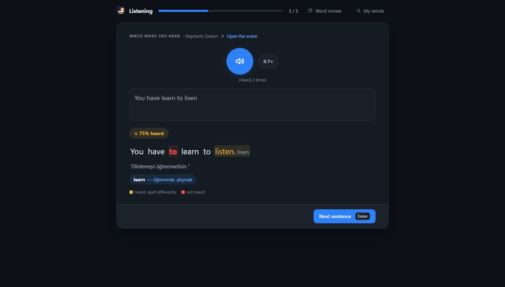
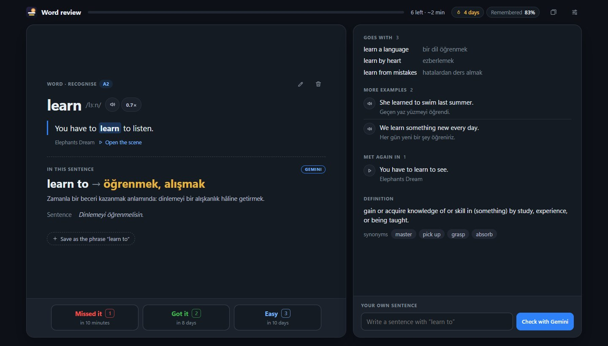

<h1 align="center">SceneLingo</h1>

  <b>Zaten izlediğin film, dizi ve videolardan dil öğren.</b> 
  Videonun üzerine iki satır altyazı koyan, üzerine geldiğin kelimeyi açıklayan 
  ve her cümleyi dinleme ve konuşma alıştırmasına çeviren bir tarayıcı eklentisi.

<a href="README.md">English</a> (teknik ayrıntılar orada)

  Görüntülerdeki film: <a href="https://commons.wikimedia.org/wiki/File:Elephants_Dream_(2006).webm"><i>Elephants Dream</i></a>
  (© Blender Foundation | Netherlands Media Art Institute, <a href="https://creativecommons.org/licenses/by/2.5/">CC BY 2.5</a>),
  kendi İngilizce ve Türkçe altyazılarıyla.

## Neden

IELTS ve iş için İngilizce öğreniyorum; dili gerçekten konuşulduğu haliyle en çok filmlerde duyuyorum. Bu iş için
en bilinen araç olan Language Reactor, benim izlediğim Amazon Prime Video'da çalışmıyor. Ben de kendi eklentimi
yazdım, çalışırken ihtiyaç duyduklarımı ekledim, sonra onu izlediğim diğer sitelere taşıdım.

## Ne yapar

- **Çift altyazı.** Üstte öğrendiğin dil, altta kendi dilin. Sitenin kendi çevirisi varsa o kullanılır; yoksa ya
  da asıl satırla örtüşmüyorsa satır makine çevirisiyle çevrilir.
- **Kelimenin üzerine gelince çeviri.** Film durur; kelimenin çevirisi, okunuşu ve sesi gelir. Tıklarsan kart
  sabitlenir ve tanım ile eş anlamlılar açılır. Birkaç kelimeyi fareyle seçersen kalıp olarak çevrilir.
- **Üç izleme biçimi**, altyazının üstündeki çalışma çubuğundan:
  - **İzle** — altyazılarla izle.
  - **Yaz** — altyazı gizlenir, her cümleden sonra film durur ve duyduğunu yazarsın. Doğru yazdığın kelimeler
    yeşil, kaçırdıkların kırmızı görünür.
  - **Söyle** — her cümleden sonra cümleyi sesli söylersin. Tarayıcının konuşma tanıması hangi kelimeleri
    anladığını gösterir; kendi kaydını da dinleyebilirsin.
- **Kelimenin cümledeki anlamı.** Sözlük "ripped" için her anlamı verir; "you ripped off the wrong people"
  cümlesinde kart *soymak* der. Cümle, kelime işaretlenerek çevrilir; çevirinin işaretli kısmı cevaptır. Kendi
  ücretsiz Gemini API anahtarınla kelimenin hangi kalıbın parçası olduğunu da söyler ve kullanımını açıklar.
  Tekrar kartlarında cümlenin çevirisiyle birlikte görünür.
- **Her sayfada seçtiğin metin.** Seçimin yanında küçük bir SL düğmesi çıkar: çeviri, sözlük bilgisi, ses ve
  geçtiği cümleyle birlikte tekrara gönderen Kaydet. Türkçe bir metin seçersen İngilizcesi gösterilir. SceneLingo'ya
  izin verilmemiş sitelerde seçime sağ tıkla.
- **Tekrar ve yavaş dinleme.** Cümleyi filmin kendi sesiyle dörtte üç hızda tekrar oynat ya da kelimeyi İngiliz,
  Amerikan veya Avustralya aksanıyla dinle.
- **Kelimeyi kullanmaya götüren aralıklı tekrar.** Kaydettiğin kelime önce tanınır, sonra kendi cümlesindeki
  boşluğa yazılır, sonra Türkçesinden İngilizcesi yazılır ya da söylenir; bilemezsen bir adım geri gider. Yazılan
  cevap kontrol edilir (küçük yazım hataları doğru sayılır), günde yeni kart sayısı sınırlıdır ve araç
  çubuğundaki simge bekleyen kartları gösterir.
- **Büyüyen kartlar.** Kaydettiğin kelime başka bir filmde yine geçerse o cümle karta örnek olarak eklenir; her
  birinin yanında sahneyi doğru anında açan bir düğme var. Gemini anahtarıyla kart; seviyesini (CEFR), birlikte
  kullanıldığı kelimeleri, iki örnek daha ve kendi yazdığın cümlenin kontrolünü de alır. Kartlar düzenlenebilir;
  bir kelime ait olduğu kalıba çevrilebilir ("ripped" → "rip off").
- **Dinleme alıştırması.** Kelimelerinin geçtiği cümleler okunur, sen duyduğunu yazarsın; sonra kelime kelime
  neyi doğru duyduğun, neyi yanlış yazdığın, neyi kaçırdığın ve cümlede olmayan neyi yazdığın gösterilir, cümlenin
  anlamıyla birlikte. Gemini varsa cümledeki kelime ve kalıplar o cümledeki anlamlarıyla listelenir, her biri tek
  dokunuşla kaydedilir; cümlenin herhangi bir kelimesine dokununca kartı açılır. Doğru duyulan cümle bir hafta dinlenir, kaçırılan ertesi gün yeniden gelir. Telefonda da
  çalışır.
- **Konuşma alıştırması.** Günlük durumlar (kafe, doktor randevusu, yeni iş arkadaşı, iş görüşmesi...) öğrendiğin
  dilde, senin seviyende Gemini ile canlandırılır: sen konuşursun, o rolüne uygun cevap verir; söylediğin her
  şey düzeltilir ve ☆ ile kaydedilebilir. İngilizcede IELTS Speaking'in üç bölümü de var (Part 2'de 1 dakika
  hazırlık, 2 dakika konuşma): her cevap dört ölçüte göre tahmini band alır; hatalar düzeltilir, band 8 bir cevap
  ve öğrenilecek ifadeler gösterilir. Kayıtlı kelimelerin "kullanmayı dene" diye önerilir; doğru kullandığın
  cümle kartına örnek olarak eklenir.
- **Yazma alıştırması.** Günlük mesaj ve mektuplar (ev sahibine, öğretmene, mağazaya...) öğrendiğin dilde, senin
  seviyende: Gemini yazının hangi seviyede olduğunu ve isteneni yapıp yapmadığını söyler, hataları düzeltir ve
  doğal hâlini verir. İngilizcede süreli IELTS Writing görevleri (Task 1 mektup ya da tablo raporu, Task 2
  deneme): dört ölçüte göre tahmini band, hatalar ve yazının band 8 hâli. Yazdıkların yazarken saklanır.
- **Okuma alıştırması.** Her gün, seçtiğin türde (hikâye, haber, seyahat, iş, bilim...) öğrendiğin dilde ve senin
  seviyende bir metin ve soruları. İngilizcede IELTS Reading'den süreli bir parça, Academic ya da General
  Training: başlık eşleştirme, TRUE / FALSE / NOT GIVEN, çoktan seçmeli ve cümle tamamlama; testin üçte biri gibi
  13 soru. Kontrolden sonra her cevabın nedeni yazar ve bir düğme metinde cevabın geçtiği yeri işaretler; IELTS
  için sınavın kendi tablosuna göre tahmini band verilir. Sonra metindeki her kelimeye dokunup anlamına bakabilir,
  cümlesiyle kaydedebilirsin. Yarım kalan test saklanır.
- **Gemini kullanımı:** bugünkü istek ve token sayısı ile son bir hafta, anahtarın yanında.
- **Bugünün planı ve hafta.** Her gün: bekleyen kartlar, 5 dinleme cümlesi ve bir konuşma; haftada iki yazı ve iki okuma.
  Eklenti penceresi neyin kaldığını gösterir ve sıradakini açar; İlerleme sayfası son yedi günü gün gün, toplamları
  ve IELTS bandlarının gidişini gösterir. Hangi alıştırmayı yaparsan yap seri devam eder. Seçtiğin saatte
  gelen bir bildirim neyin beklediğini söyler; hedefleri kendine göre değiştirebilirsin.
- **Bölümün kelimeleri ve soruları.** Satır listesinin iki yeni sekmesi var. *Kelimeler*: bu bölümde, seviyene göre
  muhtemelen bilmediğin kelimeler (film altyazılarındaki en yaygın 20.000 İngilizce ve Almanca kelimeye göre);
  kaç kez geçtiği, anlamı, satırına git düğmesi ve o satırla kaydetmek için yıldız. İsimler, ünlemler ve kayıtlı
  kelimelerin çıkmaz. Gemini ile: satırlarındaki anlamları ve bölümün deyimleri (bir kez sorulur, saklanır).
  *Sorular*: şimdiye kadar izlediğin kısımdan 5 anlama sorusu; sonrasını ele vermez, cevabın hangi satırda
  olduğunu gösterir.
- **Günlerin kaydı:** seri, öğrenilen kelime, hatırlama oranı.
- **Bütün kelimelerin tek yerde.** Kaydettiğin her kelime, kalıp ve cümle; kelimeye, anlamlarına ya da cümlesine
  göre aranır, türe, kaynağa ve durumuna göre (yeni, öğreniliyor, öğrenilen, zor) süzülür. Her satır açılınca
  bilinen her şeyi gösterir; orada düzenlenir ya da silinir.
- **Başka yerde duyulan kelimeyi elle ekleme** (telefonda da): anlamı ve telaffuzu bulunur; geçtiği cümleyi de
  yazarsan o cümledeki anlamı, yazmazsan Gemini bir cümle ve örnekler verir.
- **Yedek.** Kelimeler yalnızca tarayıcıda durduğu için liste bir yedek dosyası indirir ve geri yükler (var
  olanlarla birleştirerek); haftada bir yedek almayı hatırlatır.

| Kelime kartı | Tüm satırlar, filmin yanında |
| --- | --- |
|  |  |

| Duyduğunu yaz | Cümleyi söyle |
| --- | --- |
|  |  |

| IELTS Speaking | Günlük konuşma |
| --- | --- |
|  |  |

| Bölümün kelimeleri | |
| --- | --- |
|  | |

| İlerleme | IELTS Writing |
| --- | --- |
|  |  |

| IELTS Reading | |
| --- | --- |
|  | |

| Dinleme alıştırması | |
| --- | --- |
|  | |

| Tekrar | Bütün kelimelerin |
| --- | --- |
|  |  |

## Nerede çalışır

| Site | Altyazı nereden gelir |
| --- | --- |
| Amazon Prime Video | oynatıcıya sunulan altyazı izlerinden |
| Netflix | bölümün bilgisindeki altyazı izlerinden (oynatıcı WebVTT ve TTML de istesin diye ayarlanır); ileri geri atlama Netflix'in kendi oynatıcısıyla yapılır |
| YouTube | videonun yazılmış ya da otomatik altyazılarından; çeviri YouTube'un kendi çevirisi |
| Diğer siteler (izin verdikten sonra) | videonun yayın listesindeki altyazı izlerinden (HLS, DASH), `<track>` dosyalarından, sayfanın yüklediği altyazı dosyalarından ya da kendi `.srt` / `.vtt` / `.ass` dosyandan |

"Diğer siteler" kısmı, eklenti gerçek bir tarayıcıya yüklenerek TED (49 dil, Türkçe dahil), plyr.io, Vimeo'nun
oynatıcısı, Wikimedia Commons ve başka bir sayfaya gömülü YouTube oynatıcısında denendi. Altyazıyı videonun
parçalarının içine gömen sitelerde çalışmaz; orada kendi altyazı dosyanı açabilirsin.

## Kurulum

1. Bu depoyu indir ya da klonla.
2. `chrome://extensions` (ya da `edge://extensions`) sayfasını aç ve **Geliştirici modu**nu etkinleştir.
3. **Paketlenmemiş öğe yükle**'ye basıp `extension` klasörünü seç.
4. Prime Video, Netflix ya da YouTube'da bir şey oynat ve fareyi oynat: çalışma çubuğu altyazının üstünde belirir.
5. Diğer siteler için araç çubuğundaki SceneLingo penceresinde **Diğer sitelerde de çalış** anahtarını aç.
   Videonun altyazısı yoksa **Bu sekmedeki videoda aç** düğmesi çubuğu getirir; çubuktaki ayarlardan kendi
   altyazı dosyanı seçebilirsin.

## Telefonda ve her bilgisayarda

**Kelimelerim** sayfasında **Google ile bağlan** dersen kartların kendi Google Drive'ında, yalnızca SceneLingo'nun
görebildiği bir klasörde tutulur. Eklentinin kurulu olduğu her tarayıcı onunla eşitlenir: yarım saatte bir, kartlar
değiştikten bir dakika sonra ve günün tekrarı bitince. İki kopya kart kart birleştirilir; sonra değişen kazanır,
silinen kart da hatırlanır, böylece eski bir kopya onu geri getirmez.

Telefonda aynı tekrar ve kelime sayfaları web sayfası olarak açılır:
[umutgokbulak.github.io/SceneLingo/extension/words.html](https://umutgokbulak.github.io/SceneLingo/extension/words.html).
Aynı Google hesabıyla giriş yap; iPhone'da Safari'de **Paylaş → Ana Ekrana Ekle** onu uygulama gibi yapar.
Kelimeleri telefonun kendi sesleri okur. Çift altyazıyla izlemek bilgisayarda kalır: telefon tarayıcıları bu eklentiyi
çalıştırmaz, film uygulamalarına da eklenti eklenemez.

Bizim bir sunucumuz yok: giriş Google'ın kendi sayfasında yapılır, verdiği izin SceneLingo'nun yalnızca o klasörü bir
saat okuyup yazmasına yeter. Kurulum adımları [İngilizce README](README.md#setting-up-the-google-sign-in)'de.

## Kısayollar

| Tuş | İşlev |
| --- | --- |
| `A` / `D` | Önceki / sonraki cümle |
| `S` / `Z` | Cümleyi tekrar oynat / dörtte üç hızda tekrar oynat |
| `Q` | Her cümleden sonra duraklat |
| `W` / `E` | Yazma / söyleme alıştırmasını aç ya da kapat |
| `L` | Altyazı listesi (YouTube'da `L` ileri sardığı için düğmeden) |
| `Enter`, `↑`, `↓` | Alıştırmada: kontrol et ya da devam et, tekrar dinle, geç |

## Nasıl yapıldı

Manifest V3, yalın JavaScript; bağımlılık ve derleme adımı yok. 115 birim testi, site olmadan denenebilen her şey
için oynatıcıyı taklit eden bir test sayfası ve gerisi için eklentiyi gerçek bir tarayıcıya yükleyip yöneten bir
betik var. Altyazıların sitelerde nasıl bulunduğu, iki altyazı izinin nasıl eşleştirildiği ve yolda çıkan
sorunlar [İngilizce README](README.md#engineering-notes)'de anlatılıyor.

Cümleler, dil paketi indirildikten sonra tarayıcının kendi çevirisiyle bilgisayarda çevrilir. Ondan önce, ve
kelime kartındaki sözlük bilgisi ile seslendirme için, Google Translate'in resmî olmayan ücretsiz web ucu
kullanılır; anahtar gerektirmez ama destekli bir API değildir.

## Lisans

[MIT](LICENSE) © 2026 Umut. SceneLingo kişisel, eğitim amaçlı bir projedir; Amazon ya da Google ile bir bağı yoktur.
